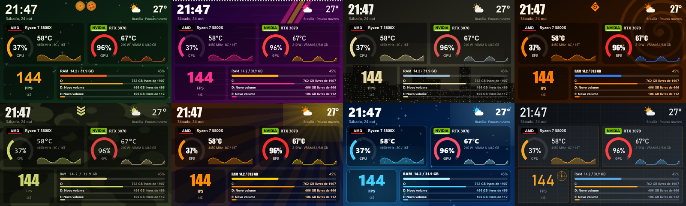

# TURZX Studio

Programa alternativo, gratuito e de código aberto para a **tela secundária TURZX de 5"**
(também vendida como "Turing Smart Screen 5 inch", 480×800). Substitui o app original por um
editor visual no navegador, com temas, skins, carrossel de telas, informações do PC,
previsão do tempo, GIFs e vídeos fluidos.



## O que ele faz

- **Editor visual**: arraste e redimensione widgets, com desfazer/refazer e prévia ao vivo.
- **Dados do PC**:
  - CPU e GPU com **nome do modelo e selo do fabricante** (AMD, NVIDIA, Intel);
  - uso, temperatura, clock, potência e VRAM;
  - RAM, rede e **espaço de cada HD/SSD**.
- **FPS dos jogos**, com tempo de quadro e o nome do jogo (ver [FPS](#fps-dos-jogos)).
- **Tempo** da sua cidade com previsão de 5 dias (Open-Meteo, sem cadastro).
- **Carrossel** de telas com **transição suave**: o brilho apaga e acende durante a troca.
- **8 temas prontos** e **skins** de cores editáveis. Use `$accent`, `$text`… nas cores
  para seguir a skin.
- **GIFs e vídeos**:
  - em áreas do painel, com o GIF rodando junto das informações;
  - ou em **tela cheia a 24 fps**: o vídeo é gravado na memória da própria tela e tocado por ela.
- **Retrato ou paisagem**, inclusive de cabeça para baixo, para telas montadas invertidas no gabinete.
- **Ícone na bandeja** e opção **Iniciar com o Windows**.

## Instalação

1. Baixe o `TURZX-Studio-x.y.z-win64.zip` em [Releases](https://github.com/brunoalbertdf-oss/turzx-studio/releases) e extraia numa pasta
   (por exemplo `C:\Programas\TURZX Studio`).
2. **Feche o app TURZX original**, porque os dois não podem usar a tela ao mesmo tempo.
3. Abra `TURZX Studio.exe`. O editor abre no navegador (`http://127.0.0.1:8777`) e um ícone
   aparece na bandeja, perto do relógio do Windows.
4. Em **Ajustes**, marque *Iniciar com o Windows* se quiser.

> O Windows SmartScreen ou o antivírus podem estranhar o executável, porque ele não é assinado
> digitalmente. Se preferir, gere o seu a partir do código ([Compilar](#compilar-a-partir-do-código)).

Seus dados ficam em `%APPDATA%\TURZX Studio`: configuração, mídias, logos e um log.

### Opcionais

| Para | Instale | Por quê |
|---|---|---|
| Vídeo fluido em tela cheia | nada (usa o `ffmpeg.exe` do app TURZX original, achado automaticamente) ou o [ffmpeg](https://ffmpeg.org) no PATH | converter GIF/vídeo para o formato da tela |
| Temperatura da CPU, GPUs AMD/Intel | [LibreHardwareMonitor](https://github.com/LibreHardwareMonitor/LibreHardwareMonitor) como administrador, com *Options → Remote Web Server → Run* | o Windows não expõe esses sensores sem driver |
| FPS dos jogos | ver abaixo | — |

### FPS dos jogos

Os apps dos fabricantes (NVIDIA App, GeForce Experience, AMD Adrenalin) não disponibilizam o
contador de FPS do overlay para outros programas. O TURZX Studio lê o FPS do
**RivaTuner Statistics Server**, que vem com o MSI Afterburner. Ele mostra o jogo em primeiro plano
e oculta medições paradas.

### Logos oficiais dos fabricantes

O programa desenha um selo com o nome e a cor de cada marca. Logos oficiais são marcas registradas
e não são distribuídos aqui. Se quiser usá-los, salve os PNGs com fundo transparente como
`amd.png`, `nvidia.png` ou `intel.png` em `%APPDATA%\TURZX Studio\logos`.

## Telas compatíveis

Testado na **TURZX 5"** (USB `VID_1D6B&PID_0106`, ID `chs_5inch.dev1_rom1.87`).
Outros modelos da mesma família (2,1", 8,8") usam um protocolo parecido, mas **não foram testados**.

## Como funciona

O protocolo foi descoberto por engenharia reversa do app original, com o
[REA](https://github.com/morluto/rea), e testado na tela. A descrição completa está em
[docs/PROTOCOLO.md](docs/PROTOCOLO.md):
- comandos;
- envio de imagens inteiras e parciais;
- gravação, reprodução e exclusão de vídeos na memória da tela.

A tela recebe cerca de **780 KB/s** pela USB. Por isso:
- uma imagem inteira leva ~1,5 s, e o app reenvia **só as áreas que mudaram**;
- GIFs ficam fluidos em áreas pequenas, de até ~240×240;
- vídeo em tela cheia funciona porque a tela grava o arquivo e toca sozinha. Nesse modo ela
  **não sobrepõe** outras imagens ao vídeo;
- a memória interna da tela tem **~10 MB**; veja e libere espaço em *Mídia → Memória da tela*.

## Compilar a partir do código

Requer Python 3.10+ no Windows.

```bat
git clone https://github.com/brunoalbertdf-oss/turzx-studio.git
cd turzx-studio
build.bat
```

O resultado fica em `dist\TURZX Studio\TURZX Studio.exe`, junto com o `.zip` para distribuir.
Para rodar sem compilar: `pip install -r requirements.txt` e `python app.py`.

| Arquivo | Função |
|---|---|
| `turzx_screen.py` | protocolo serial da tela |
| `engine.py` | carrossel, renderização, envio incremental, transições e vídeo na tela |
| `renderer.py`, `decor.py` | widgets e desenhos dos temas |
| `themes.py`, `defaults.py` | temas prontos e configuração inicial |
| `sensors.py`, `fps.py`, `weather.py` | dados do PC, FPS e tempo |
| `media.py` | imagens, GIFs, vídeos e conversão para a tela |
| `app.py`, `web/` | servidor local e editor |
| `tray.py`, `autostart.py` | bandeja e início com o Windows |

## Avisos

- Projeto independente, **sem vínculo com a TURZX** nem com os fabricantes de hardware.
- Os temas são **homenagens de fã**, feitas só com formas e cores originais. Dragon Ball, Naruto,
  Counter-Strike, Call of Duty, GTA e Forza são marcas dos seus donos. Nenhuma arte, personagem ou
  logo dessas franquias está incluído.
- A engenharia reversa foi feita para **interoperabilidade** com um aparelho próprio.
- Use por sua conta e risco. Gravar arquivos na memória da tela é seguro nos testes feitos, mas
  evite desconectar o cabo durante um envio.

## Licença

[MIT](LICENSE)
