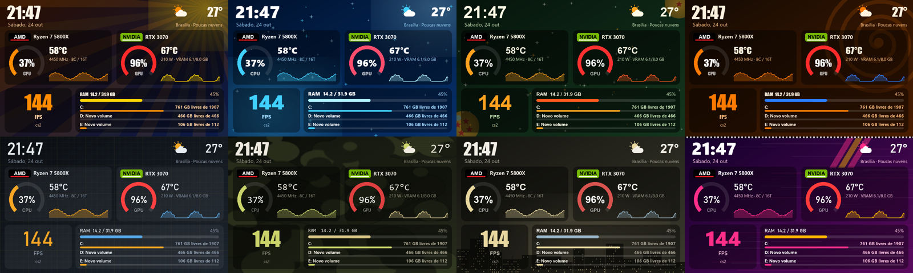

# TURZX Studio

Programa alternativo, gratuito e de código aberto para a **tela secundária TURZX de 5"**
(também vendida como "Turing Smart Screen 5 inch", 480×800). Substitui o app original por um
editor visual no navegador, com skins, carrossel de telas, informações do PC,
previsão do tempo, GIFs e vídeos fluidos.



## O que ele faz

- **Editor visual**: arraste e redimensione widgets, com desfazer/refazer e prévia ao vivo.
- **Dados do PC**:
  - CPU e GPU com **nome do modelo e selo do fabricante** (AMD, NVIDIA, Intel);
  - uso, temperatura, clock, potência e VRAM;
  - RAM, rede e **espaço de cada HD/SSD**.
- **FPS dos jogos**, com tempo de quadro e o nome do jogo (ver [FPS](#fps-dos-jogos)).
- **Tempo** da sua cidade com previsão de 5 dias (Open-Meteo, sem cadastro).
- **Carrossel** de telas com **transição suave**: o brilho apaga e acende durante a troca.
- **13 skins prontas**: Saiyajin, Super Saiyajin Blue, Esferas do Dragão, Ninja da Folha, Tático,
  Operações, Liberty, Festival, Neon Noite e outras. Cada skin muda **cores, fontes e o fundo
  decorado de todas as telas** de uma vez, sem mexer no layout. As skins são editáveis. Nas telas, use
  `$accent`, `$text`… nas cores e `$font_title`/`$font_num` nas fontes para seguir a skin.
- **Telas prontas**: "Painel completo" e "Relógio e tempo", com um botão cada.
- **GIFs e vídeos**:
  - em áreas do painel, com o GIF rodando junto das informações;
  - ou em **tela cheia a 24 fps**: o vídeo é gravado na memória da própria tela e tocado por ela.
- **Retrato ou paisagem**, inclusive de cabeça para baixo, para telas montadas invertidas no gabinete.
- **Ícone na bandeja** e opção **Iniciar com o Windows**.
- **Acompanha o PC**: a tela apaga ao desligar, reiniciar ou suspender, porque muitas placas-mãe mantêm a
  USB ligada com o PC desligado. Opcionalmente, ela **acende antes do login**, enquanto o Windows inicia,
  com relógio e uso de CPU/RAM. Para ativar: Ajustes → "Acender a tela antes do login".

## Instalação

1. Baixe o `TURZX-Studio-x.y.z-win64.zip` em [Releases](https://github.com/brunoalbertdf-oss/turzx-studio/releases) e extraia numa pasta
   (por exemplo `C:\Programas\TURZX Studio`).
2. **Feche o app TURZX original**, porque os dois não podem usar a tela ao mesmo tempo.
3. Abra `TURZX Studio.exe`. O editor abre no navegador (`http://127.0.0.1:8777`) e um ícone
   aparece na bandeja, perto do relógio do Windows.
4. Em **Ajustes**, marque *Iniciar com o Windows* se quiser.

> O Windows SmartScreen ou o antivírus podem estranhar o executável, porque ele não é assinado
> digitalmente. Se preferir, gere o seu a partir do código ([Compilar](#compilar-a-partir-do-código)).

Seus dados ficam em `%APPDATA%\TURZX Studio`: configuração, mídias, logos e um log.

### Recomendado: MSI Afterburner + RivaTuner

> **Instale o [MSI Afterburner](https://www.msi.com/Landing/afterburner/graphics-cards)** (site oficial da MSI)
> e, na instalação, deixe marcado o **RivaTuner Statistics Server**. Deixe os dois abertos e iniciando com o Windows.

O Windows não libera a temperatura da CPU nem o FPS dos jogos para programas comuns. O Afterburner
roda como administrador, mede tudo isso e compartilha os dados, e o TURZX Studio lê esses dados. Com ele aberto,
o app mostra:
- **temperatura, potência e clock da CPU**;
- **todos os dados da GPU**: temperatura, uso, potência, clock, ventoinha e VRAM, de NVIDIA, AMD ou Intel;
- o **FPS do jogo**, pelo RivaTuner (veja também o PresentMon abaixo).

No Afterburner, em *Configurações → Monitoramento*, deixe marcados *CPU temperature*, *CPU power* e
*Framerate*. Se o Afterburner não for encontrado, o TURZX Studio avisa no primeiro uso e mostra uma faixa
no editor. O estado de cada fonte aparece em **Ajustes → Fontes de dados**.

Sem o Afterburner, continuam funcionando o relógio, o tempo, o uso de CPU/GPU/RAM, os HDs, os GIFs e os
dados de GPUs NVIDIA (pelo driver).

| Para | Use |
|---|---|
| Vídeo fluido em tela cheia | nada: usa o `ffmpeg.exe` do app TURZX original, achado automaticamente. Ou instale o [ffmpeg](https://ffmpeg.org) no PATH |

### FPS dos jogos

O FPS é do jogo em primeiro plano e vem, nesta ordem, de:

1. **PresentMon** (incluído, da Intel, licença MIT). Mede pelos eventos de quadros do próprio Windows,
   sem entrar no jogo, então funciona em **todos os jogos, inclusive o CS2**, e com qualquer placa de vídeo.
   O Windows só libera essa medição para programas executados como administrador, como acontece com o app
   original da TURZX. Para ativar, vá em **Ajustes → Fontes de dados → "Ativar FPS em todos os jogos"**.
   O Windows pede permissão **uma vez** e cria uma tarefa no Agendador de Tarefas que abre o TURZX Studio
   como administrador ao fazer login, sem perguntar de novo. O botão "Desativar" remove a tarefa.
2. **RivaTuner Statistics Server**, como reserva. Jogos com proteção contra injeção, como o CS2, não
   deixam o RivaTuner medir.

### Logos oficiais dos fabricantes

O programa desenha um selo com o nome e a cor de cada marca. Logos oficiais são marcas registradas
e não são distribuídos aqui. Se quiser usá-los, salve os PNGs com fundo transparente como
`amd.png`, `nvidia.png` ou `intel.png` em `%APPDATA%\TURZX Studio\logos`.

## Problemas comuns

**A tela continua mostrando o tema do app chinês.** Quando nenhum programa conversa com ela, a tela exibe o que
tem gravado. Veja a mensagem no topo do editor (passe o mouse para ver tudo):
- *"a porta da tela está em uso por outro programa"*: o app TURZX original (`UsbMonitorL.exe`) ainda está
  rodando. Feche-o pela bandeja e tire-o da inicialização do Windows (Gerenciador de Tarefas → Inicializar).
- *"Tela TURZX não encontrada… Portas vistas: …"*: a lista mostra a identificação USB de cada porta. Abra uma
  issue com essa linha e o modelo da sua tela.

O registro fica em `%APPDATA%\TURZX Studio\turzx-studio.log`.

## Telas compatíveis

Testado na **TURZX 5"** (USB `VID_1D6B&PID_0106`, ID `chs_5inch.dev1_rom1.87`).
Outros modelos da mesma família (2,1", 8,8") usam um protocolo parecido, mas **não foram testados**.

## Como funciona

O protocolo foi descoberto por engenharia reversa do app original, com o
[REA](https://github.com/morluto/rea), e testado na tela. A descrição completa está em
[docs/PROTOCOLO.md](docs/PROTOCOLO.md):
- comandos;
- envio de imagens inteiras e parciais;
- gravação, reprodução e exclusão de vídeos na memória da tela.

A tela recebe cerca de **780 KB/s** pela USB. Por isso:
- uma imagem inteira leva ~1,5 s, e o app reenvia **só as áreas que mudaram**;
- GIFs ficam fluidos em áreas pequenas, de até ~240×240;
- vídeo em tela cheia funciona porque a tela grava o arquivo e toca sozinha. Nesse modo ela
  **não sobrepõe** outras imagens ao vídeo;
- a memória interna da tela tem **~10 MB**; veja e libere espaço em *Mídia → Memória da tela*.

## Compilar a partir do código

Requer Python 3.10+ no Windows.

```bat
git clone https://github.com/brunoalbertdf-oss/turzx-studio.git
cd turzx-studio
build.bat
```

O resultado fica em `dist\TURZX Studio\TURZX Studio.exe`, junto com o `.zip` para distribuir.
Para rodar sem compilar: `pip install -r requirements.txt` e `python app.py`.

| Arquivo | Função |
|---|---|
| `turzx_screen.py` | protocolo serial da tela |
| `engine.py` | carrossel, renderização, envio incremental, transições e vídeo na tela |
| `renderer.py`, `decor.py` | widgets e desenhos das skins |
| `themes.py`, `defaults.py` | skins e telas prontas, configuração inicial |
| `sensors.py`, `weather.py` | dados do PC e tempo |
| `afterburner.py` | sensores do MSI Afterburner |
| `fps.py`, `tools/PresentMon.exe` | FPS (PresentMon, com o RivaTuner de reserva) |
| `media.py` | imagens, GIFs, vídeos e conversão para a tela |
| `app.py`, `web/` | servidor local e editor |
| `tray.py`, `autostart.py` | bandeja, início com o Windows e modo administrador |

## Avisos

- Projeto independente, **sem vínculo com a TURZX** nem com os fabricantes de hardware.
- As skins temáticas são **homenagens de fã**, feitas só com formas e cores originais. Dragon Ball, Naruto,
  Counter-Strike, Call of Duty, GTA e Forza são marcas dos seus donos. Nenhuma arte, personagem ou
  logo dessas franquias está incluído.
- A engenharia reversa foi feita para **interoperabilidade** com um aparelho próprio.
- Use por sua conta e risco. Gravar arquivos na memória da tela é seguro nos testes feitos, mas
  evite desconectar o cabo durante um envio.

## Licença

[MIT](LICENSE). Inclui o [PresentMon](https://github.com/GameTechDev/PresentMon) da Intel, também sob licença
MIT ([third_party/PresentMon-LICENSE.txt](third_party/PresentMon-LICENSE.txt)).
